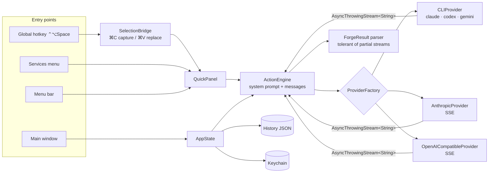

# Hone ✨

**A native macOS app that turns rough prompts into great ones and runs AI text actions on any text you select, using the AI subscription you already pay for.**

- 🪄 **Improve Prompt**: rewrites your prompt with proven prompt-engineering techniques, scores it before and after, explains what was wrong, and asks questions that make it better.
- ✍️ **Text actions**: Rewrite, Proofread, Make Concise, Professional, Friendly, Summarize, Explain, Translate, Draft Reply, plus **your own custom actions**.
- ⌨️ **Works everywhere**: select text in any app, press **⌃⌥Space**, pick an action, then **Replace** it in place or **Copy** it.
- 🔌 **Bring your own AI**: Claude, ChatGPT or Gemini **subscriptions** through their official CLIs, or an Anthropic / OpenAI-compatible **API key** (OpenAI, OpenRouter, Ollama, LM Studio…).
- 🔒 **Private by design**: no backend, no telemetry. Keys live in the macOS Keychain, and text goes only to the provider you choose.

---

## Contents
- [Install](#install)
- [First-run setup](#first-run-setup)
- [How to use](#how-to-use)
- [Providers](#providers)
- [Actions](#actions)
- [How Improve Prompt works](#how-improve-prompt-works)
- [Architecture](#architecture)
- [Design](#design)
- [Extending](#extending)
- [Building & testing](#building--testing)
- [Troubleshooting](#troubleshooting)
- [Privacy & security](#privacy--security)

---

## Install

**Requirements:** macOS 14 Sonoma or later (Apple silicon or Intel).

### Option A: DMG installer (recommended)
1. Download `Hone-<version>.dmg` from the repo's **[Releases](../../releases)** page.
2. Open it and drag **Hone** into **Applications**.
3. Open it. A notarized release (Developer ID signed) opens after the usual confirmation. An ad-hoc-signed build, including 1.0.0 (released as Prompt Forge), is blocked on first launch; clear it once:
   ```bash
   xattr -dr com.apple.quarantine "/Applications/Hone.app"
   ```
   or open it once, then click **Open Anyway** in **System Settings → Privacy & Security**.

### Option B: build from source
Requires Xcode or the Xcode Command Line Tools (Swift 5.10+). Full Xcode also compiles the accent-color asset; with only the Command Line Tools the app uses your system accent color.
```bash
gh repo clone dvd90/prompt-forge   # private repo
cd prompt-forge
./install.sh                        # builds, installs to /Applications, launches
```

---

## First-run setup

1. **Pick a provider**: open **Settings (⌘,) → Provider**. The default is **Claude Code**, so if `claude` is installed and logged in, there's nothing to do. Click **Test connection** to confirm.
2. **Grant Accessibility** (optional, recommended): **System Settings → Privacy & Security → Accessibility → Hone**. This lets the hotkey read your selection and paste results back. Without it, the hotkey works on your **clipboard** instead and Replace is hidden.
3. **Choose a hotkey**: **Settings → Shortcut**: ⌃⌥Space (default), ⌥Space, ⇧⌘Space, ⌃⌥P or disabled.

---

## How to use

### 1. Quick actions in any app
```
select text  →  ⌃⌥Space  →  press 1–9 (or click)  →  ⏎ Replace   or   ⇧⌘C Copy
```
- A floating panel appears near your cursor without stealing focus from the app you're in.
- **Replace** pastes the result over your original selection.
- **Open in App** moves the result into the main window so you can refine it.
- **Esc** closes the panel; **⌘←** goes back to the action list.

### 2. The main window
| Shortcut | What it does |
|---|---|
| ⌘↩ | Run the selected action |
| ⌘. | Stop |
| ⇧⌘C | Copy the result |
| ⌘N | New |
| ⇧⌘K | Quick actions on the clipboard |
| ⌘, | Settings |

For **Improve Prompt** you also get:
- **Score**: the draft's score and the improved prompt's score (0–100) on one gradient track, with the improved prompt and **Copy** right below it.
- **Target**: Claude, GPT, Gemini, Any LLM, Coding agent (Claude Code / Cursor) or Image model. The rewrite follows each target's conventions.
- **Depth**: *Light* (minimal edits), *Standard*, or *Production* (a reusable system prompt with `{{VARIABLES}}`).
- **Techniques**: leave on *auto*, or force specific ones: Role, Context & why, Success criteria, Structure / tags, Examples, Step-by-step, Output format, Edge cases, Variables.
- **Goal**: optional notes on who uses the prompt and what a great answer looks like.
- **Questions**: answer them inline and click **Re-run with answers** to fill the placeholders.
- **Refine**: free-text feedback ("shorter", "return JSON") that keeps the conversation going.

Every run is saved to **History** in the sidebar. Click an entry to reopen it and keep refining; right-click to copy or delete.

### 3. Right-click Services
Select text → right-click → **Services → Hone: Improve Prompt** or **Hone: Quick Actions**.
You can bind these to keys in **System Settings → Keyboard → Keyboard Shortcuts → Services**.

### 4. Menu bar
The ✨ wand icon gives you quick actions on the selection or clipboard, opens the window, and shows the active provider. The app keeps running in the menu bar after you close the window, so the hotkey always works.

---

## Providers

| Provider | Auth | Streaming | Setup |
|---|---|---|---|
| **Claude Code** *(default)* | Claude Pro / Max subscription | ✅ | Install [Claude Code](https://docs.claude.com/en/docs/claude-code) and run `claude` once to log in |
| **Codex CLI** | ChatGPT subscription | ❌ (result arrives at once) | Install Codex and run `codex login` |
| **Gemini CLI** | Google account | ✅ | Install Gemini CLI and run `gemini` once, choosing "Login with Google" |
| **Anthropic API** | API key | ✅ | Paste a key from console.anthropic.com and pick a model |
| **OpenAI-compatible** | API key (optional for local) | ✅ | Preset buttons for OpenAI, OpenRouter, Ollama and LM Studio; enter a model ID |

**How subscription mode works:** Hone runs the official CLI in headless mode, so requests use your existing login and count against your plan. No tokens are copied or stored. Calls are isolated:

- **Claude Code:** `claude -p --system-prompt … --tools "" --setting-sources "" --strict-mcp-config --disable-slash-commands --no-session-persistence`. No tools, no hooks, no MCP servers, no CLAUDE.md and no session files, so your personal Claude Code setup can't leak into results.
- **Codex:** `codex exec --ephemeral -s read-only --skip-git-repo-check`.
- **Gemini:** `gemini -p --approval-mode plan` (read-only).

All CLIs run in an empty temp folder. GUI apps don't inherit your shell `PATH`, so Hone reads it once from a login shell. Settings shows where each CLI was found.

You can set a model for each provider; leave it blank to use the CLI's default (for Claude Code: `sonnet`, `opus`, `haiku` or a full model ID).

---

## Actions

| # | Action | What it does |
|---|---|---|
| 1 | **Improve Prompt** | Structured prompt-engineering report (see below) |
| 2 | Rewrite | Clearer, better structured, same voice and length |
| 3 | Proofread | Spelling, grammar and punctuation only |
| 4 | Make Concise | Cuts filler and keeps every point |
| 5 | Professional | Confident, clear work tone |
| 6 | Friendly | Warm, natural tone |
| 7 | Summarize | Short bullet list, most important point first |
| 8 | Explain | Plain-language explanation |
| 9 | To English | Idiomatic translation that keeps formatting |
| – | Draft Reply | Replies to a message as you, with `{{placeholders}}` for unknowns |

**Custom actions:** **Settings → Actions → Add custom action**. Give it a name, an icon and an instruction, e.g. *"Turn this into a LinkedIn post with a strong hook, max 120 words."* It appears in the main window and the quick panel straight away. You can hide any built-in action with its toggle. The first 9 visible actions get number keys.

All text actions use the same guarded system prompt: the selected text is treated as **content, never as instructions**, so selected text saying "ignore previous instructions" gets proofread, not obeyed. Output is the result only, with no preamble, in the original language and formatting.

---

## How Improve Prompt works

The meta-prompt is based on Anthropic's and OpenAI's published prompting guidance. It tells the model to:

- be explicit about the task, the audience and what "done" means
- give context and the *why* behind instructions
- say what to do, not only what to avoid
- separate instructions, context, data and examples (XML tags for Claude; headings or delimiters elsewhere)
- use examples only when they reduce ambiguity
- set the output format and length
- add step-by-step reasoning or planning for complex tasks
- cover edge cases and missing information
- **never invent facts**: unknowns become `{{PLACEHOLDERS}}` plus a question
- keep the draft's language and cut padding

The model replies in a fixed tagged format, which the app parses while it streams:

```
<score_before> → <diagnosis> → <improved_prompt> → <changes> → <questions> → <score_after>
```

---

## Architecture



```
Sources/PromptForge/
├── PromptForgeApp.swift        App, menu bar, commands, AppDelegate
├── AppState.swift              Main-window state, history, settings, engine
├── Models.swift                ForgeResult parser, targets, depth, techniques, history
├── MetaPrompt.swift            The prompt-engineering system prompt
├── Actions/Actions.swift       AIAction registry + ActionEngine
├── Providers/
│   ├── Provider.swift          LLMProvider protocol, ProviderKind, settings, Keychain
│   ├── HTTPProviders.swift     Anthropic + OpenAI-compatible (SSE)
│   └── CLIProvider.swift       Claude Code / Codex / Gemini CLI + PATH resolution
├── System/SystemIntegration.swift   Carbon hotkey, selection capture/paste, Services
└── UI/
    ├── Views.swift             Main window
    ├── QuickPanel.swift        Floating non-activating panel
    ├── SettingsView.swift      Provider / Actions / Shortcut tabs
    └── Theme.swift             Design tokens, ScoreMeter, shared rows, wells and motion
```

**Data on disk**
- History: `~/Library/Application Support/PromptForge/history-v2.json` (last 300 runs)
- Settings: `UserDefaults` (`com.dvd90.PromptForge`)
- API keys: Keychain, service `com.dvd90.PromptForge`

Hone shipped as Prompt Forge in 1.0. The bundle ID, Swift module, Keychain service and data paths keep the `PromptForge` name so existing settings, keys and history carry over.

---

## Design

Hone's look is adapted from Dial, a macOS menu-bar time tracker: graphite (dark) and mist (light) surfaces, hairline-ruled sections, one periwinkle accent, and the score drawn as a sunrise-gradient track. Controls and navigation stay standard macOS, and the app follows the system light/dark setting.

- [`DESIGN.md`](DESIGN.md): tokens (colors, type, spacing), components and rules.
- [`PRODUCT.md`](PRODUCT.md): who Hone is for and the principles design decisions follow.

Accessibility: text meets WCAG AA contrast in both appearances, animations respect Reduce Motion, and the score track has a VoiceOver label.

---

## Extending

**Add a built-in action**: append one entry in `Actions/Actions.swift`:
```swift
builtIn("bulletize", "Bullet Points", "list.dash",
        "Convert this text into a clean bulleted list."),
```

**Add a provider**:
1. Conform to the protocol:
   ```swift
   protocol LLMProvider {
       func stream(system: String, messages: [ChatMessage], maxTokens: Int)
           -> AsyncThrowingStream<String, Error>
   }
   ```
2. Add a case to `ProviderKind` and a branch in `ProviderFactory.make`.
3. Add its fields to `ProviderSettingsView`.

**Add a new kind of output** (beyond `promptEngineer` and `transform`): add an `AIAction.Kind` case and handle it in `ActionEngine.system / firstMessage / followUp / displayText`.

---

## Building & testing

```bash
swift build                               # debug build
./build.sh                                # → build/Hone.app (Developer ID signed if installed, else ad-hoc)
./build.sh --install                      # … and copy to /Applications
./install.sh                              # quit running copy, install, register Services, launch
scripts/make_dmg.sh                       # → build/Hone-<version>.dmg (signed + notarized when a Developer ID cert is installed)
swift scripts/make_icon.swift && iconutil -c icns AppIcon.iconset   # regenerate the icon

swift test                                # unit tests (parser, actions, CLI flattening, saved-data decoding, layout)
PF_LIVE=1 swift test --filter LiveTests   # real calls via your claude + codex logins
```

**One-time signing setup** (needed for notarized releases)
1. Xcode → Settings → Accounts → your team → **Manage Certificates… → + → Developer ID Application** (the Account Holder must create it). `build.sh` picks it up automatically.
2. Store notarization credentials in the Keychain (asks for an [app-specific password](https://account.apple.com)):
   ```bash
   xcrun notarytool store-credentials hone-notary --apple-id <your-apple-id> --team-id <your-team-id>
   ```

**Release a new version**
```bash
/usr/libexec/PlistBuddy -c "Set CFBundleShortVersionString 1.1.0" Info.plist
scripts/make_dmg.sh
gh release create v1.1.0 build/Hone-1.1.0.dmg --title "v1.1.0" --notes "…"
```

---

## Troubleshooting

| Symptom | Fix |
|---|---|
| "Hone can't be opened" | Only for ad-hoc builds (not notarized): `xattr -dr com.apple.quarantine "/Applications/Hone.app"` |
| Hotkey does nothing | Another app may own the combo. Pick another in Settings → Shortcut |
| Hotkey uses the clipboard instead of the selection; no Replace button | Grant Accessibility. Developer ID builds keep the grant; **after every rebuild** of an ad-hoc build, remove and re-add it in the Accessibility list |
| "Couldn't find the `claude` command" | Settings → Provider shows where it looked. Install the CLI, or make sure it's on your login-shell `PATH` |
| `Claude Code failed: … login` | Run `claude` in Terminal and sign in |
| Gemini: "Please set an Auth method" | Run `gemini` once and choose "Login with Google" |
| OpenAI-compatible: 404 | The base URL must end at `/v1` (e.g. `https://api.openai.com/v1`) and the model ID must exist |
| Services entries missing | Run `/System/Library/CoreServices/pbs -update`, then log out and back in |

---

## Privacy & security

- No servers, accounts or analytics. The app talks only to the provider you select (or runs its local CLI).
- API keys are stored in the macOS **Keychain**, never in plain text.
- Selected text is wrapped in delimiters and labelled as content, which hardens the actions against prompt injection.
- CLI calls run **without tools**, in a read-only or plan mode and an empty temp folder, so a model can't touch your files.
- After capturing a selection with ⌘C, the app restores your clipboard (all types).

---

<sub>Built with SwiftUI · macOS 14+ · no third-party dependencies.</sub>
